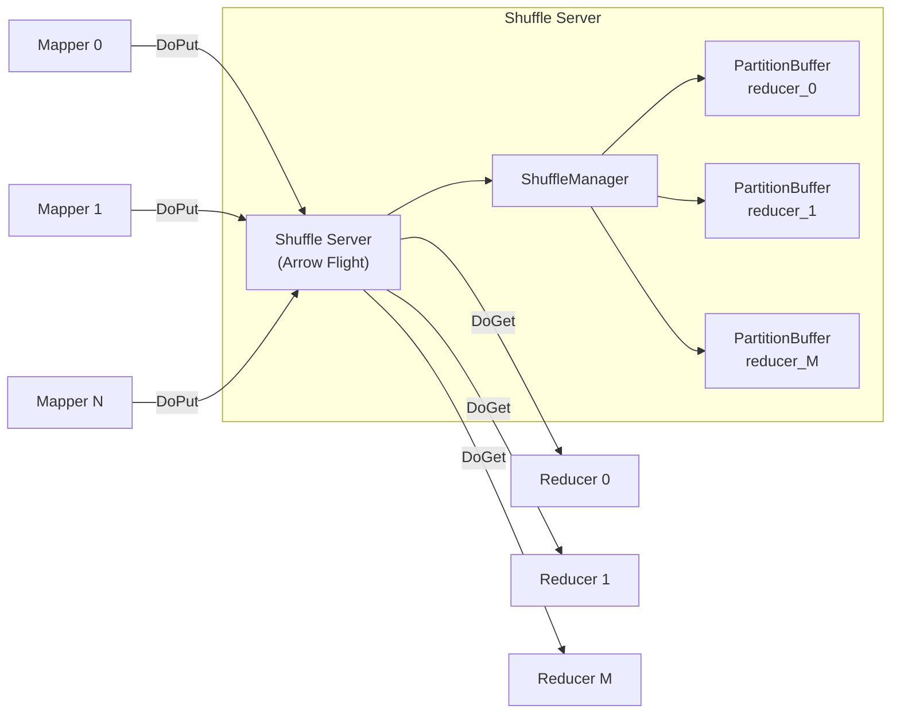

# Arrow Rust Shuffle Service

A high-performance, **external shuffle service** written in Rust, leveraging **Apache Arrow Flight** (built on gRPC/Tonic) for zero-copy data transport.

Inspired by modern push-based shuffle systems like [Apache Celeborn](https://github.com/apache/celeborn), this service aggregates incoming mapper data **on-the-fly** by Reducer ID. This allows reducers to fetch a single consolidated stream directly from the server, eliminating the need to query multiple mapper nodes or merge hundreds of small files.

---

## 📖 Architecture & Design

In traditional pull-based shuffles, $M$ mappers write partition files locally on their disk. A job with $M$ mappers and $R$ reducers creates $M \times R$ logical partitions, producing excessive random I/O and small files.

This service utilizes a **push-based shuffle** design:
1. **Push Phase**: Mappers push their `RecordBatch` streams directly to the shuffle service using Arrow Flight's `DoPut` RPC, targeting a specific `(shuffle_id, reducer_id)` partition.
2. **Aggregation & Spilling**: The server aggregates batches for each `reducer_id` in-memory. If a partition's memory footprint exceeds the configured threshold, the server spills the data as a consolidated `.arrow` IPC file to disk.
3. **Fetch Phase**: Reducers fetch their aggregated stream using Arrow Flight's `DoGet` RPC, which streams the spilled files followed by any remaining in-memory batches.



---

## 📂 Project Structure

This workspace contains two crates:

- **shuffle-server**: The core external shuffle service.
- **test-client**: A simulator client and integration test suite.

```
arrowRustShuffle/
├── Cargo.toml                  # Workspace Root
├── shuffle-server/             # Shuffle Server Crate
│   ├── Cargo.toml
│   └── src/
│       ├── main.rs              # Server entry point & CLI parser
│       ├── lib.rs               # Re-exports for test usage
│       ├── partition.rs         # PartitionBuffer logic (in-memory buffering + spilling)
│       ├── shuffle_manager.rs   # ShuffleManager (keys routing and management)
│       └── flight_service.rs    # Arrow Flight Service implementation
└── test-client/                # Test Client Crate
    ├── Cargo.toml
    ├── src/
    │   ├── main.rs              # Standalone client/server demo
    │   └── lib.rs               # Simulator helpers (mappers & reducers)
    └── tests/
        └── integration_test.rs  # End-to-end integration tests
```

---

## ⚡ Core Components

### 1. PartitionBuffer
Manages buffering and disk spilling for a single `(shuffle_id, reducer_id)` partition.
- Accumulates `RecordBatch`es in memory.
- Dynamically tracks buffer memory footprint via `RecordBatch::get_array_memory_size`.
- Spills to `.arrow` IPC files in the directory `spill_dir/{shuffle_id}/reducer_{id}/spill_{epoch}.arrow` when the memory threshold is reached.
- Streams back merged data in sequential order (spill files first, then remaining memory buffer).

### 2. ShuffleManager
A thread-safe entry point that maps and routes incoming `RecordBatch` streams to the corresponding [PartitionBuffer](shuffle-server/src/partition.rs) based on `(shuffle_id, reducer_id)`.

### 3. ShuffleFlightService
Implements the gRPC-based `FlightService` from the `arrow-flight` crate:

| RPC Method | Descriptor/Ticket Format | Purpose |
| :--- | :--- | :--- |
| `DoPut` | Path: `[shuffle_id, reducer_id]` | Mappers upload partition batches |
| `DoGet` | Ticket: `"{shuffle_id}/{reducer_id}"` | Reducers stream merged partition data |
| `GetFlightInfo` | Path: `[shuffle_id, reducer_id]` | Query partition metadata and endpoint info |
| `ListFlights` | None | Listing all registered shuffle partitions |

---

## 🚀 Getting Started

### Prerequisites

Ensure you have Rust and Cargo installed:
```bash
curl --proto '=https' --tlsv1.2 -sSf https://sh.rustup.rs | sh
```

### Running the Shuffle Server

To start the standalone shuffle service:
```bash
cargo run -p shuffle-server -- --port 50051 --spill-dir /tmp/shuffle-spill --spill-threshold-mb 64
```

#### CLI Configuration Options:
- `--port`: The port to run the server on (default: `50051`).
- `--spill-dir`: Location where spilled `.arrow` files will be written (default: `/tmp/shuffle-spill`).
- `--spill-threshold-mb`: Max memory size in MB for a single partition buffer before spilling to disk (default: `64`).

### Running the Demo Client

The demo client starts an embedded shuffle server with a very low spill threshold (`4 KB`) to show the transition between in-memory buffering and disk spilling, runs 4 simulated mappers pushing data, and 3 simulated reducers fetching it back:
```bash
cargo run -p test-client
```

### Running Tests

To run all unit and integration tests across the workspace:
```bash
cargo test --workspace -- --nocapture
```

The tests cover:
- In-memory partition buffer lifecycle.
- Spill-to-disk verification and file path checks.
- End-to-end mapper-to-reducer Arrow Flight integration.
